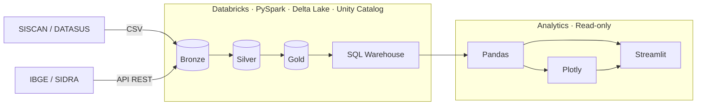

# SISCAN Data Analytics

[](https://github.com/ThaisdosSantos/siscan-data-analytics/actions/workflows/streamlit-syntax.yml)
[](https://www.python.org/)
[](https://spark.apache.org/docs/latest/api/python/)
[](https://www.databricks.com/)
[](https://delta.io/)
[](https://pandas.pydata.org/)
[](https://plotly.com/python/)
[](https://streamlit.io/)
[](https://docs.pytest.org/)
[](https://playwright.dev/python/)

Pipeline de dados end-to-end e plataforma analítica para exploração de dados sobre exames citopatológicos do colo do útero na 10ª Coordenadoria Regional de Saúde do Rio Grande do Sul (10ª CRS), abrangendo 11 municípios entre 2020 e 2025.

O projeto integra dados públicos do SISCAN/DATASUS e do IBGE, centralizando indicadores de produção de exames, distribuição territorial, evolução temporal, perfil etário, adequabilidade das amostras, resultados citopatológicos e Outubro Rosa.

**[Acessar a plataforma analítica](https://siscan-data-analytics-rmvxtnyhxnphdaygum54uy.streamlit.app/)**

## Arquitetura e decisões técnicas



- **Processamento em lote:** arquitetura Medallion com persistência em Delta Lake, rastreabilidade dos arquivos de origem e validações entre camadas.
- **Desacoplamento entre processamento e consumo:** materialização de tabelas analíticas na Gold, reduzindo a necessidade de transformações durante a execução da aplicação.
- **Consumo read-only:** consultas via Databricks SQL Connector e cache de dados com TTL de uma hora, reduzindo consultas repetidas ao SQL Warehouse.
- **Data Quality:** validações de esquema, domínio, integridade e completude temporal ao longo do pipeline.
- **Testes independentes da infraestrutura:** utilização de fixtures sintéticas para validação das métricas e da interface sem dependência de conexão com o Databricks.

## Stack tecnológica

| Componente | Tecnologias |
| --- | --- |
| Data Engineering | Python, PySpark, Databricks |
| Storage & Governance | Delta Lake, Unity Catalog |
| Analytics | Databricks SQL, Pandas |
| Data Visualization | Streamlit, Plotly |
| Testing | pytest, Playwright |
| Continuous Integration | GitHub Actions |

## Abrangência territorial

| Município | Código IBGE |
| --- | --- |
| Alegrete | 430040 |
| Barra do Quaraí | 430187 |
| Itaqui | 431060 |
| Maçambará | 431171 |
| Manoel Viana | 431175 |
| Quaraí | 431530 |
| Rosário do Sul | 431640 |
| Santa Margarida do Sul | 431697 |
| Sant'Ana do Livramento | 431710 |
| São Gabriel | 431830 |
| Uruguaiana | 432240 |

## Pipeline de dados

Os notebooks disponíveis em [`notebooks/`](notebooks/) implementam o fluxo de processamento em lote no Databricks.

| Ordem | Notebook | Operação |
| --- | --- | --- |
| 1 | [01 — Bronze](notebooks/01_bronze_ingestion_siscan.ipynb) | Ingestão dos arquivos CSV e metadados de rastreabilidade. |
| 2 | [02 — Silver](notebooks/02_silver_cleaning_siscan.ipynb) | Normalização, tratamento de inconsistências e validação dos registros. |
| 3 | [06 — IBGE](notebooks/06_extracao_api_ibge_populacao.ipynb) | Extração via API SIDRA e materialização da dimensão populacional. |
| 4 | [03 — Gold](notebooks/03_gold_analytics_siscan.ipynb) | Agregação, integração dimensional e materialização das tabelas analíticas. |
| 5 | [05 — Auditoria](notebooks/05_auditoria_meses_silver.ipynb) | Verificação de integridade e completude temporal entre camadas. |

**Volume de ingestão:** disponibilizar `dataset/` ou `dataset.zip` em:

```text
/Volumes/tcc-analise-siscan-10crs/bronze/siscan_files_bronze/
```

**Reprodutibilidade:** as tabelas `fato_outubro_rosa_grupo_etario` e `fato_outubro_rosa_mensal_grupo_etario` derivam de extrações específicas do TABNET e devem estar previamente disponíveis no schema Gold.

A execução da aplicação no ambiente Databricks é disponibilizada pelo [notebook 04 — Streamlit](notebooks/04_run_streamlit_app.ipynb).

## Quick Start

**Pré-requisitos:** Python 3.11 e acesso a um Databricks SQL Warehouse com permissões de leitura no schema Gold.

### Configuração do ambiente

```bash
git clone https://github.com/ThaisdosSantos/siscan-data-analytics.git
cd siscan-data-analytics

python -m venv .venv
source .venv/bin/activate

pip install -r src/app/requirements.txt
```

### Configuração da conexão

Configure as variáveis de ambiente ou o arquivo `.streamlit/secrets.toml` na raiz do repositório:

```toml
DATABRICKS_SERVER_HOSTNAME = "seu-workspace.cloud.databricks.com"
DATABRICKS_HTTP_PATH = "/sql/1.0/warehouses/seu-warehouse"
DATABRICKS_TOKEN = "seu-token"
DATABRICKS_CATALOG = "tcc-analise-siscan-10crs"
```

### Execução

```bash
streamlit run src/app/main.py
```

## Testes e integração contínua

O [workflow de CI](.github/workflows/streamlit-syntax.yml) automatiza a validação sintática, os testes unitários das métricas e os testes end-to-end com Playwright/Chromium.

```bash
pip install -r requirements-test.txt
playwright install chromium

# Validação sintática
python -m compileall -q src/app tests

# Testes unitários
pytest tests/test_metrics.py -v

# Testes end-to-end
pytest tests/e2e -v --browser chromium
```

Os testes E2E utilizam dados sintéticos, com publicação de relatórios e evidências de execução pelo GitHub Actions.

[Documentação dos testes E2E](tests/e2e/README.md)

## Premissas analíticas

- **Unidade de análise:** exames registrados, não indivíduos únicos.
- **Completude temporal:** 71 de 72 competências mensais, com ausência de dados em agosto de 2022.
- **Razão anual de exames:** denominador fixo baseado na população feminina de 25 a 64 anos do Censo 2022, não representando cobertura populacional.
- **Proporção de exames alterados:** denominador operacional estimado mediante distribuição proporcional das exclusões de amostras insatisfatórias e rejeitadas por faixa etária.
- **Outubro Rosa:** análise descritiva, sem inferência causal.

## Fontes de dados

- [SISCAN/DATASUS — TABNET](https://datasus.saude.gov.br/informacoes-de-saude-tabnet/)
- [IBGE/SIDRA — Censo Demográfico 2022, Tabela 9514](https://sidra.ibge.gov.br/tabela/9514)
